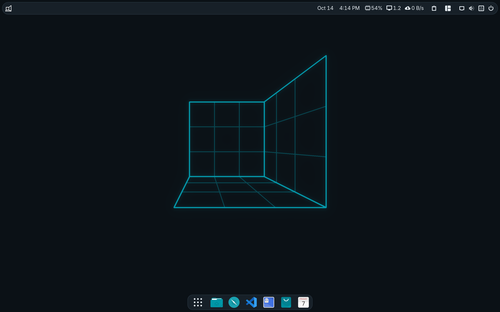

# Construct

A GNOME desktop on [Wolfi](https://github.com/wolfi-dev): one image, read-only and checked block
by block, updated as a whole into a second slot, and rolled back by itself when a new version does
not come up.



Construct is days old. Its first release is from 5 October 2026, versions are dates
(`20261014.2`), and every release goes to the `testing` channel first and to `stable` when it has
proved itself there. It is built for one person's laptop at a time, not yet for a fleet; expect
rough edges, and say where they are.

- **GNOME 51** on Wayland, with GNOME's core apps (Files, Text Editor, Calendar, Maps, Software,
  Papers, ...), Firefox, Ptyxis and Ghostty, and Flatpak with Flathub, where Chrome comes from.
  For work: Docker and containerd, VS Code (Microsoft's build, under its license), gcc, make and
  git, Tailscale, CUPS, OpenSSH.
- **Its own look**: Orchis in Construct's colours for the shell, GTK 3 and libadwaita apps alike,
  following the light/dark switch; Tela icons; Bibata's cursor. A top bar with the clock and
  indicators on the right, and a small centred dock. Extensions: AppIndicator, Caffeine, Clipboard
  Indicator, Dash to Panel, Desktop Icons, Drive Menu, Just Perfection, Night Theme Switcher,
  Tiling Shell, User Theme, Vitals, Workspace Indicator.
- **Built for GNOME 51, fixed where it is not**: the theme, the icons, the cursor and six of the
  extensions come from [forks](https://github.com/Construct-Linux) with a `gnome-51` branch -
  upstream's issues triaged against this stack, one commit per fix - and each recipe pins its
  commit and names the fixes it takes.
- **What Wolfi lacks is built here**: 208 melange recipes in `recipes/` - the GNOME stack, and
  Wolfi packages rebuilt where Wolfi's fall short (mesa with Intel's drivers and Vulkan, PipeWire
  with Bluetooth audio, systemd with TPM2 and sysupdate, ...).
- **Its own kernel**: Arch Linux's set of drivers, with Construct's boot and hardening over it,
  modules signed by a key that exists only in its build, built with Clang ThinLTO for x86-64-v3,
  sched_ext with scx_lavd.
- **Boot**: UEFI, systemd-boot, a unified kernel image with Plymouth playing the brand's animation
  and a systemd initrd, the way systemd's image-based distributions boot. `/var` holds everything a
  machine keeps; `/etc` is an overlay on it, so settings persist.
- **Updates**: signed (Ed25519) releases from the update CDN, checked daily, written into the slot
  not running; or from a release's USB stick. Nothing reboots by itself; a version that does not
  bring the desktop up three times is dropped for the one before it.
- **Every release ships its evidence**: a signed `SHA256SUMS`, the image's SBOM (SPDX) and its
  Grype scan, on the [release](https://github.com/Construct-Linux/os/releases).

## What it needs

- A PC with **UEFI** firmware. There is no legacy BIOS boot.
- An **x86-64-v3** CPU: Intel from Haswell (2013) or AMD from Zen. Everything is compiled for that
  level, and an older CPU does not boot.
- A GPU the kernel drives itself: Intel (i915, xe), AMD (amdgpu), NVIDIA through nouveau. There
  is no proprietary NVIDIA driver.
- A **TPM 2.0**, optionally: with one, the disk opens with the password as the TPM's PIN; without,
  the password alone opens it.
- A USB stick of **16 GB** or more for the live system and installer. 32 GB is comfortable.
- **A disk to give it whole.** Installing erases the machine's first internal disk. There is no
  dual boot and no partitioning of your own.

Not here: ARM, legacy BIOS, dual boot, a proprietary NVIDIA driver.

## Install

**Download and check it.** A release is a USB stick image at <https://dl.constructlinux.org>,
listed in its `SHA256SUMS` newest first, signed with the release key at
<https://keys.constructlinux.org/release.pgp> (Ed25519,
`FCDF AC7C 34B3 3EAC E30E FDC1 FB37 0710 D987 11C3`). On a Mac, `brew install gnupg xz` first.

```sh
curl -fLO https://dl.constructlinux.org/SHA256SUMS
curl -fLO https://dl.constructlinux.org/SHA256SUMS.gpg
curl -fL https://keys.constructlinux.org/release.pgp | gpg --import
gpg --verify SHA256SUMS.gpg SHA256SUMS                     # Good signature, the fingerprint above
v=$(sed -n '1s/.*construct_\(.*\)\.raw\.xz$/\1/p' SHA256SUMS)  # the newest release
curl -fLO https://dl.constructlinux.org/construct_$v.raw.xz
grep " construct_$v.raw.xz\$" SHA256SUMS | shasum -a 256 -c  # construct_$v.raw.xz: OK
```

**Write it to the stick**, which loses everything on it. The image is 6.8 GB written; the live
system takes the rest of the stick for its `/var` on first boot. Find the stick's device, and be
sure of it: the wrong one is another disk erased.

On Linux (`lsblk` names it, `/dev/sdX`; unmount its partitions if the desktop mounted them):

```sh
xz -dc construct_$v.raw.xz | sudo dd of=/dev/sdX bs=4M oflag=direct conv=fsync status=progress
```

On a Mac (`diskutil list` names it, `/dev/diskN`; the raw device `rdiskN` writes faster):

```sh
diskutil unmountDisk /dev/diskN
xz -dc construct_$v.raw.xz | sudo dd of=/dev/rdiskN bs=4m
diskutil eject /dev/diskN
```

Or with a window: GNOME Disks (*Restore Disk Image*) and balenaEtcher take the `.raw.xz` as it is.

**Enroll Secure Boot.** systemd-boot and every kernel image are signed with Construct's key, which
the stick carries for the firmware. Put the firmware's Secure Boot in setup mode (its menu calls
it "clear keys", "reset to setup mode" or "delete all keys"), boot the stick from the firmware's
boot menu (F12 on a ThinkPad), hold any key while the stick starts so that systemd-boot shows its
menu, and choose *Enroll Secure Boot keys: auto*; the machine restarts and from then on boots only
what Construct signed. The same menu offers the boot without the splash, for a boot that stops
somewhere, and `systemctl reboot --boot-loader-menu=10` opens it once from a running desktop. The keys keep Microsoft's certificates for graphics
and network cards' own firmware, not Windows'.

**Install from the live session.** The stick boots a desktop, as the user `live`, that opens
*Install Construct* (or `sudo construct install` in a terminal). It asks for the disk and who the
machine is for - a name, a login and one password - then erases that disk and lays two system
slots and `/var` on it. It shows a **recovery key once**: write it down, it opens the disk in place
of a forgotten password. Take the stick out and restart.

## Living with it

- **One password.** It opens the encrypted disk at boot (LUKS2; as the TPM's PIN where there is a
  TPM, which only releases the key to kernel images Construct signed), and the desktop starts
  logged in. sudo and the lock screen ask for it again. root has no password and cannot log in.
- **A security key** (FIDO2, `construct key add`) also opens the disk, with its PIN and a
  touch, and its touch answers sudo, polkit and the lock screen. **A fingerprint**, enrolled in
  Settings, answers the login and lock screens only, beside the password.
- **Updates** are checked once a day and written into the slot not running; a notice says when a
  restart will start the new version. A machine follows `stable` unless told to follow `testing`
  (`sudo construct channel testing`). A release's stick, plugged in, is an update too. A version
  that fails to bring the desktop up three times is dropped for the one before it.
- **Factory reset**: `sudo systemctl start factory-reset.target` restarts the machine, makes
  `/var` anew (every person, file, container and setting gone; the system slots untouched) and
  GNOME's Initial Setup asks who it is for. The disk still opens with the password it was installed
  with: to hand the machine to someone else, install it again from the stick.
- **Something wrong?** `construct report` prints what an [issue](https://github.com/Construct-Linux/os/issues/new/choose)
  needs; `construct diagnose` collects logs for a harder one. A security flaw goes privately, as
  `SECURITY.md` says.

## Build it

Everything is a task (`task --list`); the build needs Docker, Go, QEMU and swtpm. What it fetches
from outside is pinned in `build/versions.env`, the host tools a release is built with in
`build/host.env`. Your own builds are signed with keys of your own, outside the repository.

```sh
task keygen:release keygen:pcr keygen:secureboot   # once: the release, PCR and Secure Boot keys
task usb                                           # -> _output/usb/disk.raw, a stick like a release's
task test:usb                                      # boots it by UEFI in QEMU and checks the desktop
task play                                          # the stick in a window, with a disk to install on
```

`AGENTS.md` is the contributor's guide: the rules, the layout, and what each kind of change is
checked with. `task check` is what CI runs on a pull request; a pull request from outside the
organization waits for a maintainer to approve its CI run. A fix to the theme, the icons, the
cursor or an extension belongs in its [fork](https://github.com/Construct-Linux), on its
`gnome-51` branch.

## License

Apache License 2.0 (`LICENSE`), but for `kernel/patches/`: patches to Linux, GPL-2.0 as Linux is,
each with its author in its header. The packages the recipes build and the image ships keep their
own licenses, which each recipe names.
